# 💰 Cognevance Expense Tracker & Analytics System

A Python-based personal finance management application designed to help users manage income, track expenses, generate financial reports, and visualize financial data through charts.

The project uses Python, SQLite, and Matplotlib to provide an integrated expense tracking and financial analytics solution.

## 🚀 Features

### 1. User Authentication
- User registration and login
- Password hashing using PBKDF2
- Username and email validation
- User-specific transaction management

### 2. Income Management
- Add income records
- View income transactions
- Search income records
- Update income details
- Delete income records
- Calculate total income

### 3. Expense Management
- Add and manage expenses
- View expense history
- Search, update, and delete expenses
- Categorize expenses
- Calculate total expenses
- Generate category-wise expense summaries

### 4. Financial Reports
- Monthly financial reports
- Yearly financial reports
- Monthly income and expense comparisons
- Overall financial summaries
- Savings calculations

### 5. Financial Analytics & Visualization
The application generates four types of charts using Matplotlib:

- Monthly Income vs Expenses Bar Chart
- Expense Category Pie Chart
- Monthly Savings Trend Line Chart
- Yearly Financial Comparison Chart

Generated charts are saved automatically in the `charts/` directory.

## 🛠️ Technologies Used

| Technology | Purpose |
|---|---|
| Python | Core programming language |
| SQLite | Database management |
| Matplotlib | Data visualization |
| SQL | Database queries |
| Git & GitHub | Version control |

## 📂 Project Structure

```text
Cognevance_Expense_Tracker/
│
├── main.py
├── database.py
├── authentication.py
├── income.py
├── expenses.py
├── reports.py
├── analytics.py
│
├── data/
│   └── expense_tracker.db
│
├── charts/
│   ├── expense_category.png
│   ├── income_expense_2026.png
│   ├── savings_trend_2026.png
│   └── yearly_comparison.png
│
├── screenshots/
│   ├── main_menu.png
│   ├── registration.png
│   ├── login_page.png
│   ├── income_management.png
│   ├── expense_management.png
│   ├── financial_reports.png
│   └── exit_message.png
│
├── requirements.txt
├── README.md
└── .gitignore
```

## ⚙️ Installation and Setup

### Step 1: Clone the Repository

```bash
git clone YOUR_GITHUB_REPOSITORY_URL
```

### Step 2: Navigate to the Project Directory

```bash
cd Cognevance_Expense_Tracker
```

### Step 3: Install Dependencies

```bash
pip install -r requirements.txt
```

### Step 4: Run the Application

```bash
python main.py
```

The application initializes the SQLite database and creates the required tables automatically when it starts.

## 📸 Application Screenshots

### Main Menu

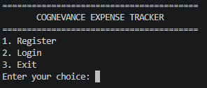

### User Registration

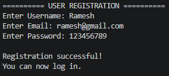

### User Login

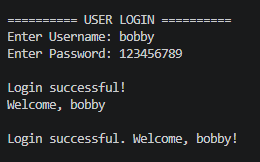

### Income Management

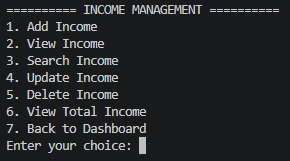

### Expense Management

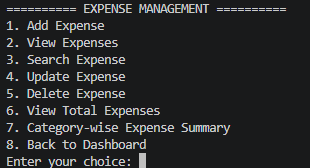

### Financial Reports

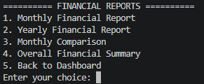

### Application Exit

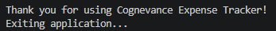

## 📊 Financial Analytics & Charts

The following charts are generated from the application's transaction data.

### 1. Monthly Income vs Expenses

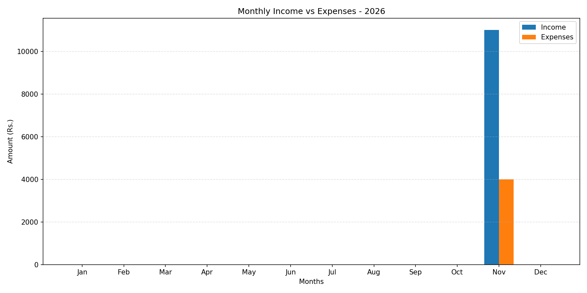

### 2. Expense Category Analysis

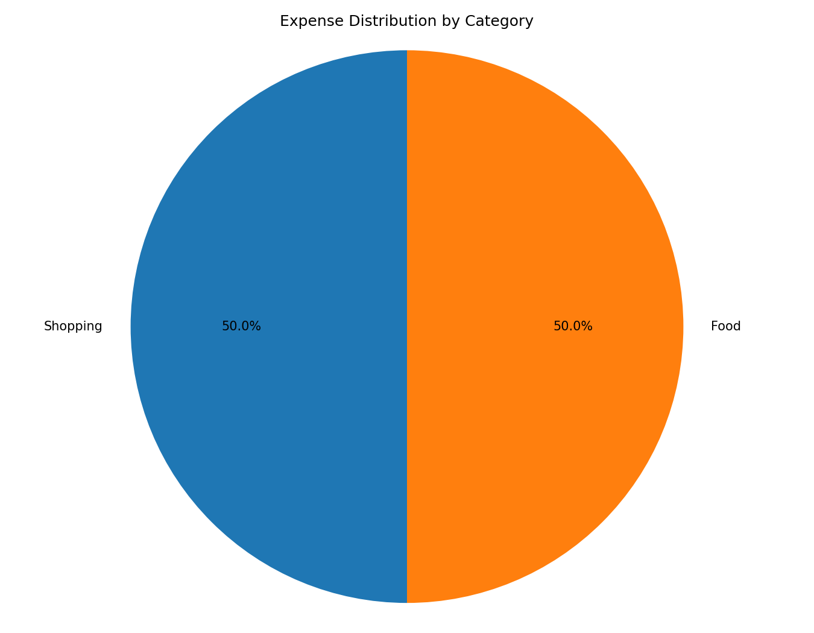

### 3. Monthly Savings Trend

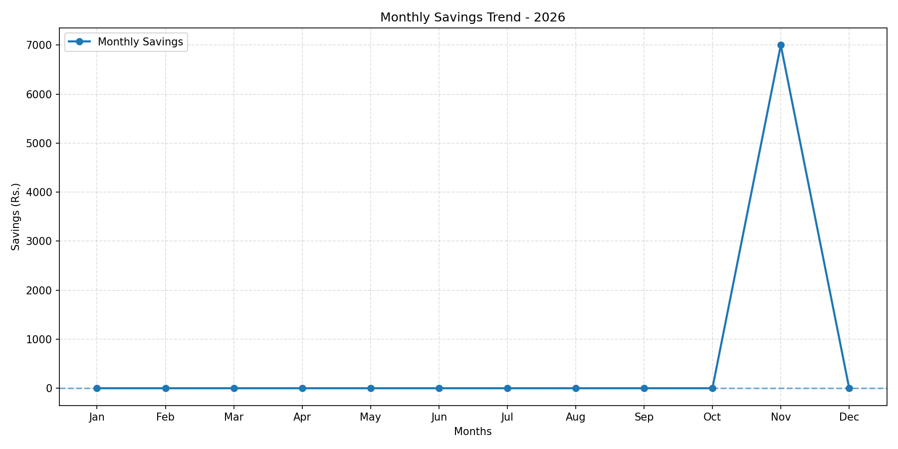

### 4. Yearly Financial Comparison

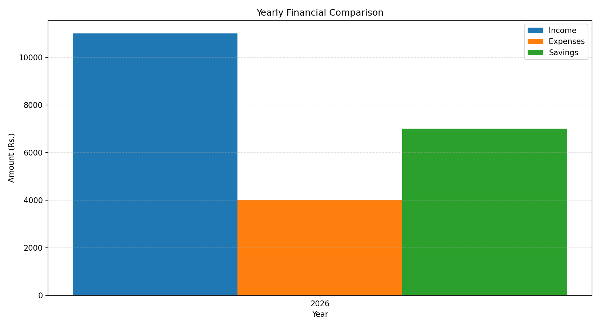

## 🧮 Financial Calculations

**Total Savings**

```text
Total Savings = Total Income - Total Expenses
```

**Category-wise Expenses**

Expenses are organized into the following categories:

- Food
- Travel
- Education
- Shopping
- Entertainment
- Bills
- Health
- Other

## 🗄️ Database Management

The application uses SQLite as its database.

It contains two primary tables:

**Users**
- Stores user account information.
- Maintains unique usernames and email addresses.
- Stores hashed passwords.

**Transactions**
- Stores income and expense records.
- Maintains transaction amounts, categories, descriptions, and dates.
- Associates each transaction with its respective user.

## 🎯 Project Objectives

- Apply Python programming concepts in a real-world application.
- Implement modular programming.
- Perform database operations using SQLite.
- Implement user authentication.
- Generate financial reports using SQL queries.
- Visualize financial data using Matplotlib.
- Develop an integrated command-line application.

## 🔮 Future Enhancements

- Graphical User Interface using Tkinter or CustomTkinter.
- Export financial reports to PDF and Excel.
- Monthly budget planning.
- Spending alerts and notifications.
- Advanced financial analytics.
- Cloud database integration.

📚 Internship Details
Organization: Cognevance Technologies

Domain: Python Programming

Project Level: Level 2 – Intermediate

Project Title: Student Record Management System

👨‍💻 Author
Golla Ramesh Karthik Dheeraj

Python Programming Intern

Cognevance Technologies

⭐ If you find this project useful, feel free to explore the repository!